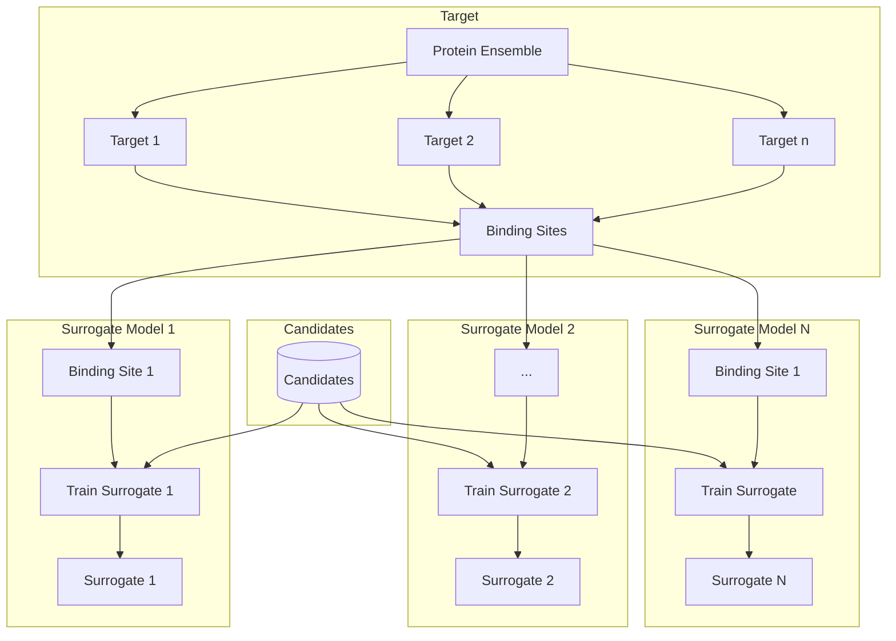

# High-level Architecture

## Overview

Lynceus is orchestrated using [Argo Workflows](https://argoproj.github.io/workflows/) running on kubernetes.

## High-level Workflow

## Components

[surrogate](components/surrogate.md)
