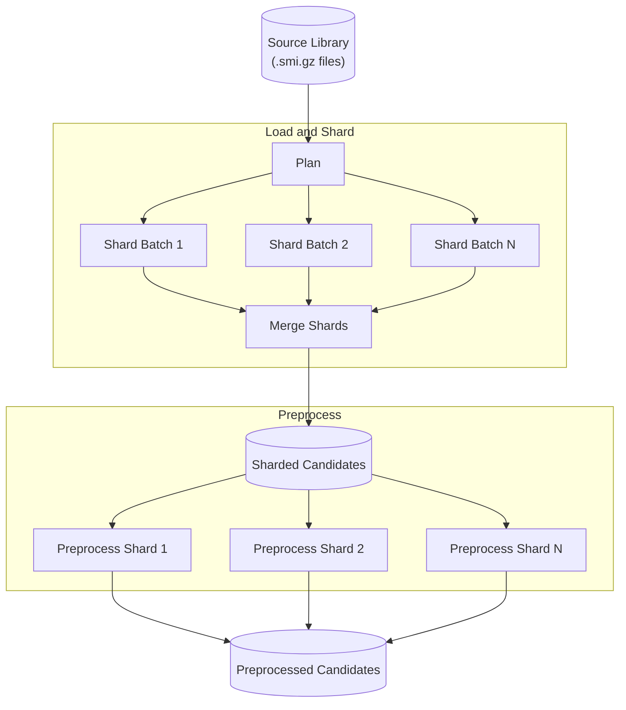

# Candidates

## Overview

Candidates are the compounds screened against each binding site. This page covers how a candidate library is loaded and prepared before it reaches the surrogate model. Lynceus is built to handle libraries of up to roughly a billion compounds, such as ZINC22, so every stage is designed to run in parallel over partitions of the library rather than over the library as a whole.

The output of this stage is a single preprocessed candidate set. It is shared by every binding site and consumed by the [surrogate model](surrogate.md).

## Workflow

## Stages

### Load and shard

The source library is supplied as many compressed SMILES files. Loading reads these files in parallel and writes them into a fixed number of hash-partitioned Parquet shards.

1. **Plan:** inspect the source files and group them into batches of bounded size, so each batch fits comfortably in a single pod.
1. **Shard:** each batch is processed independently, and every compound is assigned to a shard by hashing its identifier. Because the assignment is a pure function of the identifier, shards are uniform in size and a given compound always lands in the same shard.
1. **Merge:** the small files written for each shard are consolidated into a single Parquet file per shard.

The result is a library split into a fixed number of evenly sized shards (512 by default), which later stages can process in parallel and from which they can draw representative samples.

### Preprocess

Each shard is standardized and prepared for downstream use, so that every later stage works from the same consistent representation of the library.

## Outputs

| Output | Description |
| --- | --- |
| Sharded candidates | The full library as evenly sized, hash-partitioned Parquet shards |
| Preprocessed candidates | The standardized library, shared by all binding sites |

## Next steps

Preprocessed candidates are sampled to train a surrogate model for each binding site, and the trained surrogates are then applied to the full library. See [Surrogate Model](surrogate.md) for details.
