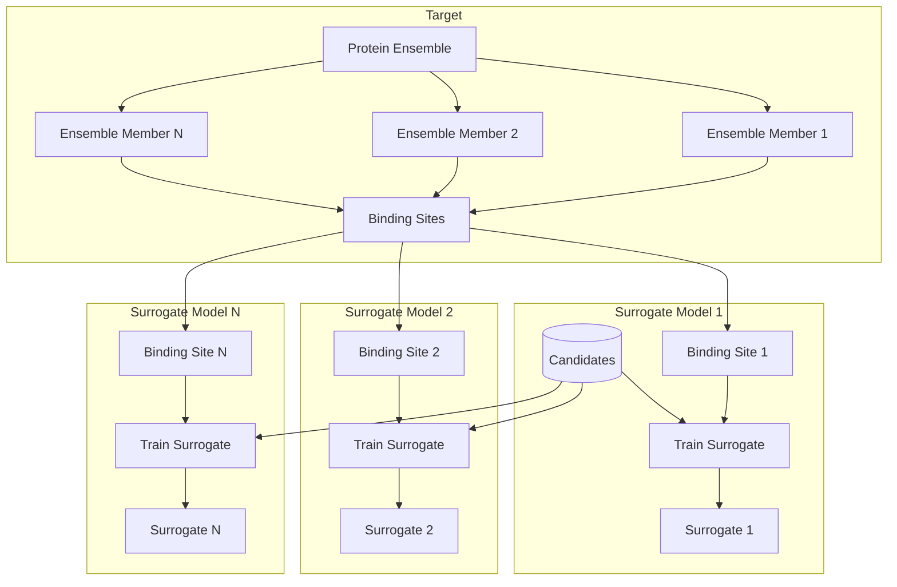

# High-Level Architecture

## Overview

Lynceus is orchestrated with [Argo Workflows](https://argoproj.github.io/workflows/) running on Kubernetes.

A single run carries one target ensemble. Binding sites are detected on every ensemble member and consolidated into a distinct set of physical binding sites. From that point on, each binding site gets its own independent surrogate model, trained against the shared candidate library.

This page shows how the stages fit together. Candidate preparation and surrogate modeling are covered in detail on their own pages.

## High-Level Workflow

## Further Reading

- [Candidates](candidates.md): how candidate libraries are retrieved, preprocessed, repartitioned, and filtered before screening.
- [Surrogate Model](surrogate.md): how each per-site surrogate is trained, and how it is used to filter the full library before docking.
