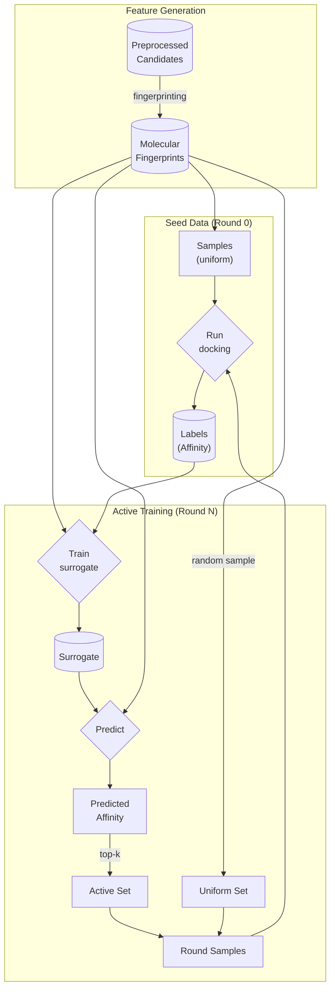

# Surrogate

## Overview

Active learning using gradient boosted trees over molecular fingerprint features, trained per binding site.

Fingerprints are computed from the conformers produced during [candidate preprocessing](candidates.md). Preprocessing is independent of the binding site, so its computational cost is amortized across every surrogate.

## Workflow

