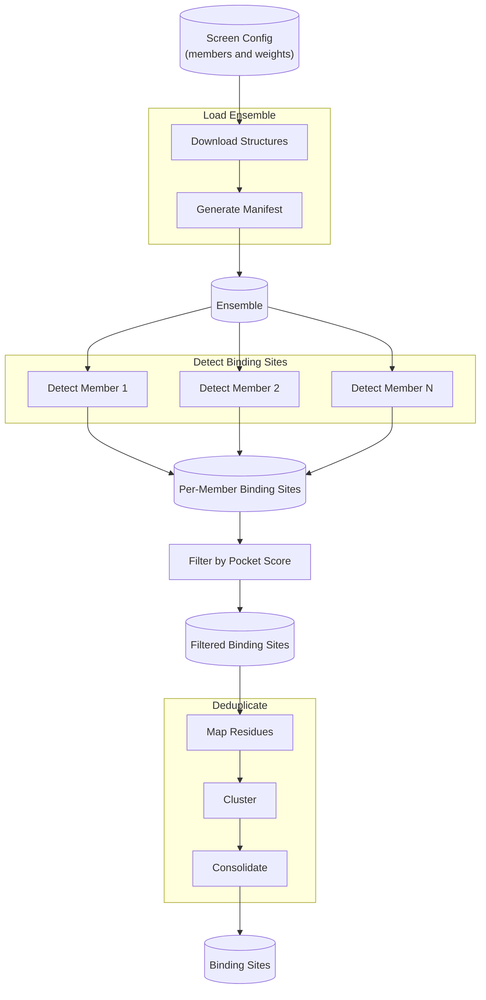

# Targets

## Overview

Targets are the proteins that candidates are screened against. Lynceus does not treat a target as a single rigid structure. Each target is represented as an ensemble of conformational states, and the screen is built around the distinct binding sites those states expose. This page covers how an ensemble is loaded, how binding sites are detected across its members, and how those per-member sites are consolidated into the distinct sites that the rest of the pipeline runs on.

The output of this stage is a set of deduplicated binding sites. Each site records which ensemble members it was found in. Every later stage runs once per site, so this set determines how the downstream work fans out. It is consumed together with the preprocessed candidates by the [surrogate model](surrogate.md).

## Workflow

## Stages

### Load ensemble

The screen configuration lists each ensemble's members together with a weight for each member. Member weights must sum to 1.0. Structures are downloaded and a manifest is generated that describes the ensemble: its members, a content hash for each member structure, and the weights.

Weights express how much each member counts. They are not required to reflect biological populations. An ensemble can deliberately over-represent a rare state so that the sites it exposes are not drowned out by the common ones.

### Detect binding sites

Binding site detection runs on every ensemble member independently using P2Rank. The work per member is light, so members are processed in parallel within a single task instead of as separate workflow tasks.

Each detected pocket records its center, an approximate spatial extent, a pocket score, and the residues that line it. The result is a list of candidate sites per member, in which the same physical site usually appears once for every member that exposes it.

### Filter

Pockets scoring below the configured minimum are discarded. Filtering happens before deduplication so that weak, low-confidence pockets cannot bridge two otherwise distinct sites and cause them to merge. The stage fails if no pocket in the ensemble passes the threshold.

### Deduplicate

The same binding site is detected separately in each member that contains it. Deduplication consolidates these into one entry per physical site.

1. **Map residues:** member structures differ in construct boundaries, tags, and missing residues, so their residue numbering is not directly comparable. Each chain is aligned to a single reference sequence chosen from the ensemble, and every lining residue is translated to that reference numbering. Pockets are then compared as sets of residues rather than as coordinates, which removes the need for the members to share a coordinate frame. A member whose residues map poorly causes the stage to fail instead of contributing partial data.
1. **Cluster:** pockets are grouped by residue overlap using average-linkage clustering with a fixed similarity threshold. The result does not depend on the order in which members are supplied, and average linkage prevents a chain of weakly overlapping pockets from merging unrelated sites.
1. **Consolidate:** each cluster becomes one site. A member contributes at most one pocket to a site, the highest scoring, so symmetric chains within a member do not inflate the site. The site carries a consensus residue set, the members it was found in with their individual scores and centers, and the total weight of those members.

Pockets that sit entirely within a larger pocket, such as a sub-pocket of an extended cavity, are not merged into it. The containment relationship is recorded alongside the sites so that it can be inspected without changing which sites are screened.

Each site is given an identifier derived from its content, so the same inputs always produce the same identifier.

## Outputs

| Output | Description |
| --- | --- |
| Ensemble | The member structures and a manifest with content hashes and weights |
| Per-member binding sites | Every pocket detected in every member, including lining residues |
| Filtered binding sites | The per-member pockets that pass the minimum pocket score |
| Binding sites | The distinct sites, each with its member list, per-member scores and centers, consensus residues, and total member weight |

## Next steps

Each binding site is processed independently from here. Preprocessed candidates are sampled to train a surrogate model for each site, and the trained surrogates are applied to the full library. See [Surrogate Model](surrogate.md) for details and [Candidates](candidates.md) for how the library is prepared.
