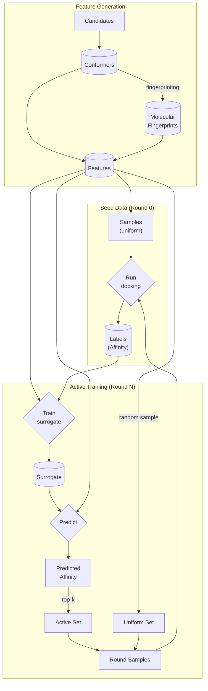

# Surrogate

## Overview

Active learning using gradient boosted trees over physiochemical feature vectors per target.

Preprocessing of candidates is independent of the target and so the computational cost is amoritized.

## Workflow

